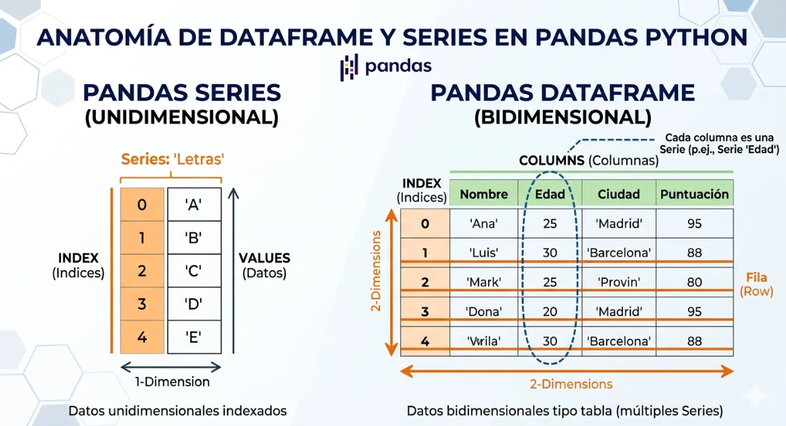
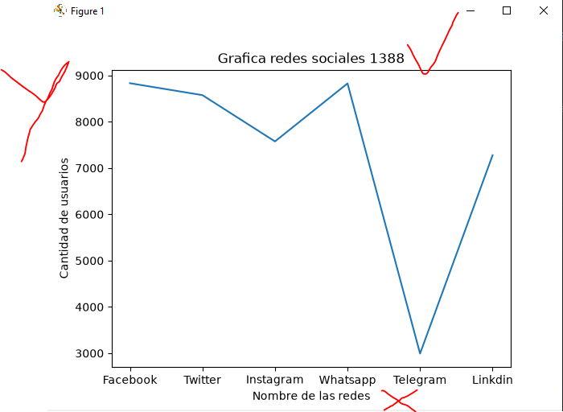
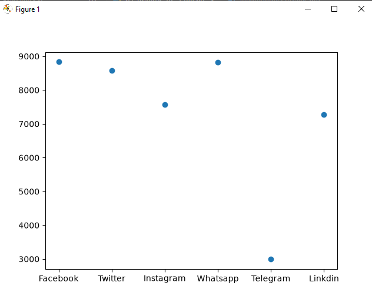
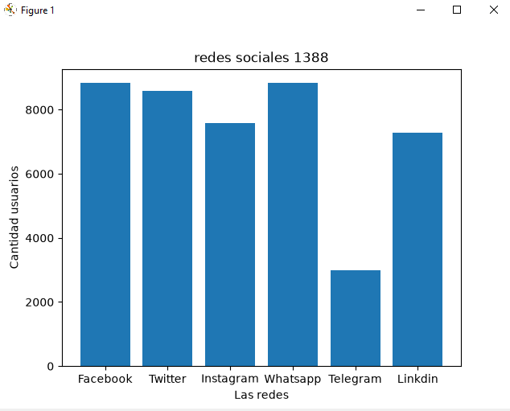
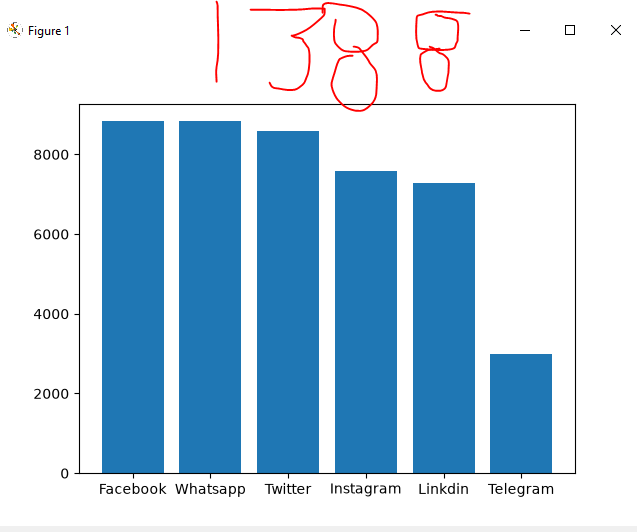
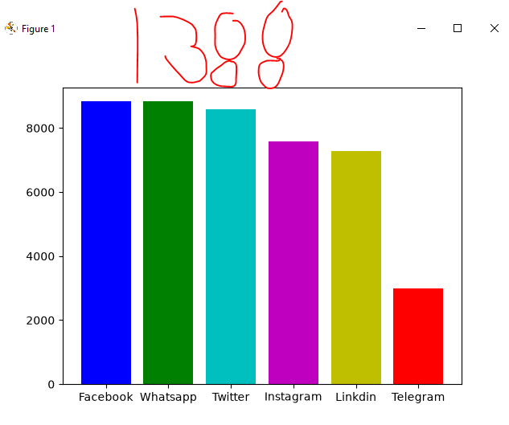
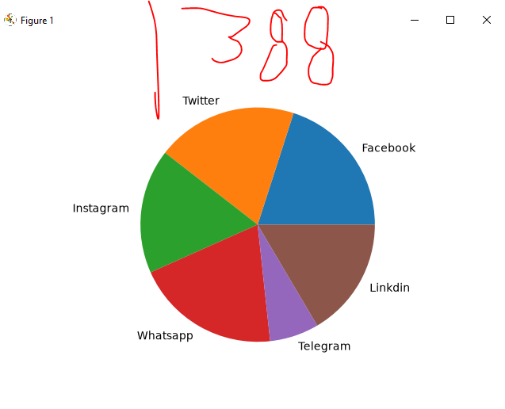

## DataFrame o marco de datos

## redes sociales a nivel mundial

## grafica de redes sociales

## grafica puntos de redes sociales

##  Grafica de barras de redes sociales

## grafica de bar4ras del mas grande al mas chico Decendente

## coloreando la graica

## grafica pastel
